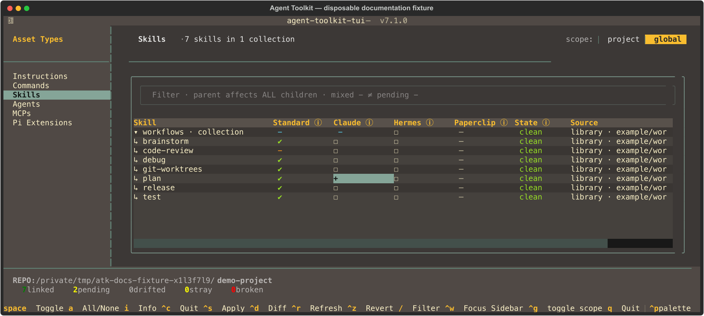

# Agent Toolkit CLI

  

Keep AI-agent assets under your control across coding harnesses.

## Overview

Manage **skills, agents, commands, instructions, Pi extensions, and MCP servers** from a Python CLI or Textual terminal interface. Keep source-backed assets in a library, then choose which harnesses can see them at project or global scope. Local skill improvements are real Git work: update by merging upstream and publish through a pull request.

The toolkit creates symlinks, translates Markdown, or edits named configuration entries as each harness requires. **Support and verbs vary by kind and scope**; catalog membership is not universal support. Instructions uses your canonical `AGENTS.md` and actual filesystem pointers, not a lock. Bundles are an installation utility for skills, agents, and Pi extensions, not a seventh asset kind.

[Documentation](https://ajanderson1.github.io/agent-toolkit-cli/) · [Compatibility matrix](docs/matrix.md) · [CLI reference](docs/agent-toolkit/cli.md) · [TUI reference](docs/agent-toolkit/tui.md)

## Installation

Requires **Python 3.12+**, [uv](https://docs.astral.sh/uv/) and Git. Install the **toolkit package** (both binaries):

```bash
uv tool install --from git+https://github.com/ajanderson1/agent-toolkit-cli agent-toolkit
agent-toolkit-cli --version
```

This tracks the repository's default branch. For an immutable release, append its tag to the Git URL. Verified wheel/sdist assets are available on [GitHub Releases](https://github.com/ajanderson1/agent-toolkit-cli/releases); no PyPI publication is configured. The incompatible pre-v2 commands remain frozen at `v1.0.0`; see [legacy installation](docs/agent-toolkit/cli.md#pre-v2-surface).

## Quickstart

```bash
# 1. Add source to the library — does not make it visible to a harness.
agent-toolkit-cli skills add anthropics/skills --skill pdf

# 2. Install a projection in the current project; the library remains separate.
agent-toolkit-cli skills install pdf --agents claude-code --scope project
agent-toolkit-cli skills list -p

# 3. Inspect or queue visibility changes in the terminal UI.
agent-toolkit-tui
```

Choose scope explicitly in scripts. Defaults differ across kinds and verbs: a Git repository alone does not select project scope. See [scope rules](docs/agent-toolkit/cli.md#scope-and-target-selection).

## Usage

```bash
# Register a repository's real skills; install its registered children together.
agent-toolkit-cli skills add --source owner/repo --ref main
agent-toolkit-cli skills install --source owner/repo --agents standard --scope global

# Inspect local edits, merge upstream, then publish an owned skill through a PR.
agent-toolkit-cli skills status pdf -g
agent-toolkit-cli skills update pdf -g
agent-toolkit-cli skills push my-owned-skill -g

# Share an existing user-authored project AGENTS.md with Claude Code.
agent-toolkit-cli instructions install --scope project --harness claude-code

# Discover each group's actual verbs and flags.
agent-toolkit-cli commands --help
agent-toolkit-cli mcps --help
agent-toolkit-cli bundles --help
```

Canonical groups are `skills`, `agents`, `commands`, `instructions`, `pi-extensions`, `mcps`, and `bundles`; singular aliases still work. `uninstall` removes visibility without forgetting source-backed library content; `remove` can delete that content. **MCP is an exception:** remove retains its library manifest and files. See the [verb model](docs/glossary.md#verb-model), [six asset guides](docs/index.md#asset-types), and [skill ownership workflow](docs/agent-toolkit/skill-lock.md).

## Configuration

- Source-backed libraries and global locks normally live under `~/.agent-toolkit/`; project locks describe their own scope. [Storage reference](docs/agent-toolkit/lock-files.md).
- Instructions canonical content is user-owned: project `AGENTS.md` or `~/.agent-toolkit/AGENTS.md`. Install does not author it. [Instructions safety](docs/asset-types/instructions.md).
- TUI theme and main-harness columns are preferences, not CLI install targets. Use **Ctrl+P → Theme / Main harnesses**. [Settings schema and overrides](docs/agent-toolkit/tui-settings.md).

## Screenshot



Fresh disposable-fixture capture of this source tree, not operator assets. Collection controls include collapsed and filter-hidden members; **Apply** runs queues across all six kinds, **Revert** clears them, and failures remain visible for retry. Apply is not a cross-kind atomic transaction. [Controls and limits](docs/agent-toolkit/tui.md) · [Reproduce the capture](docs/assets/screenshots/README.md).

## Architecture

- `src/agent_toolkit_cli/`: Click groups, canonical libraries, locks, Git operations and harness adapters.
- `src/agent_toolkit_tui/`: Textual grids over the same inventory and installation facades.
- `docs/agent-toolkit/harness-matrix.md`: packaged compatibility data; `scripts/gen_harness_docs.py` generates matrix/harness views from it and maintained catalog/support tables.

[Storage model](docs/agent-toolkit/lock-files.md) · [Compatibility data](docs/agent-toolkit/harness-matrix.md) · [Unshipped ideas](docs/agent-toolkit/roadmap.md)

## Contributing

```bash
git clone https://github.com/ajanderson1/agent-toolkit-cli
cd agent-toolkit-cli
uv sync --all-extras
uv run pytest -q
uv run python scripts/gen_harness_docs.py
make docs-build
```

`lefthook.yml` runs the full pytest suite on **pre-push**. Update affected docs with behavior changes; regenerate harness pages rather than editing generated output. [Open an issue](https://github.com/ajanderson1/agent-toolkit-cli/issues) for defects or compatibility gaps.

## License

[MIT with Commons Clause](LICENSE): use, modify and distribute, but do not sell the software or products/services whose value derives substantially from it.

## Acknowledgements

The skills catalog and compatible lock format build on [vercel-labs/skills](https://github.com/vercel-labs/skills). The terminal interface uses [Textual](https://textual.textualize.io/).
