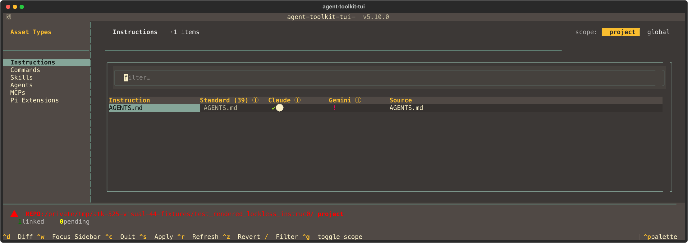
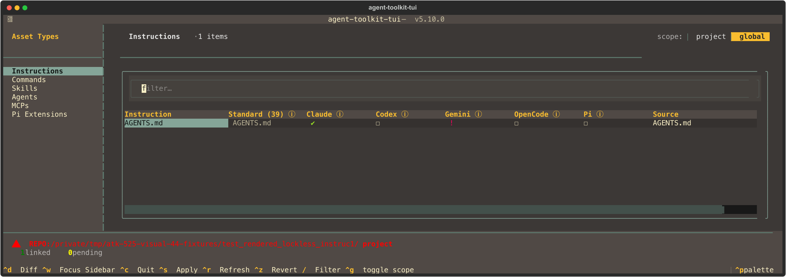

# #525 Instructions visual verification

**Capture code:** `44b36bb88ffb59588502b757d9d9f072506775ee`.
The PR body identifies the final reviewed head and full-gate results separately.
These images prove rendered fixture states, not a full-suite or merge approval.

Four fresh Textual `run_test(size=(180, 30))` captures from
`tests/test_tui/test_instruction_lockless.py::test_rendered_lockless_instruction_evidence`.
CLI and TUI imports were asserted beneath the author's owned source tree at the
capture code revision. All data is disposable: a project/home beneath the
controlled `/tmp/atk-525-visual-44-fixtures` root, synthetic canonical text, a real
Claude symlink and a foreign Gemini regular file. No operator HOME/configuration,
private content or transcripts are included. PNGs were newly rendered from these
SVGs with `rsvg-convert`; no previous author's image was reused.

**Capture checks:** 4 passed, 15 deselected. All four PNGs were visually inspected.
Gitleaks directory scan passed; each SVG also passed an explicit stdin scan
(the default directory scan excludes image extensions).
The fixture directories intentionally are not Git repositories, so their red REPO
warning is expected. The font renders the project global-indicator globe as a
solid circular fallback; visible-cell assertions separately verify its meaning.

## Project — healthy canonical

**PASS:** project scope and Instructions sidebar are selected; one neutral
`AGENTS.md` canonical row; Claude is linked with a global indicator; the foreign
Gemini file is a red conflict, not an installed link.

[Original SVG](instructions-project.svg)

## Global — healthy canonical

**PASS:** global scope is selected; canonical is neutral; Claude is linked;
Codex/OpenCode/Pi are absent; Gemini is a red conflict. No project global-shadow
indicator appears.

[Original SVG](instructions-global.svg)

## Project — missing canonical

**PASS:** project scope stays selected; canonical visibly says `missing`; the
owned dangling Claude pointer remains linked/visible with its global indicator;
Gemini remains a separate conflict and the row does not disappear.

[Original SVG](instructions-project-broken.svg)

## Global — missing canonical

**PASS:** global scope stays selected; canonical visibly says `missing`; the
owned dangling Claude pointer remains visible; Gemini remains a conflict and
absent managed columns remain distinct. No misleading foreign installed glyph.

[Original SVG](instructions-global-broken.svg)

## Evidence boundary

This directory is tracked for GitHub/PR review and excluded from the public
MkDocs site by the existing `reviews/` exclusion. Raw local captures, cell-state
JSON, source-assertion helper, logs and local manifest remain under ignored
`assets/verification/525/` or temporary storage, not in this review bundle.
The PNG and SVG pairs above contain only controlled fixture output.
