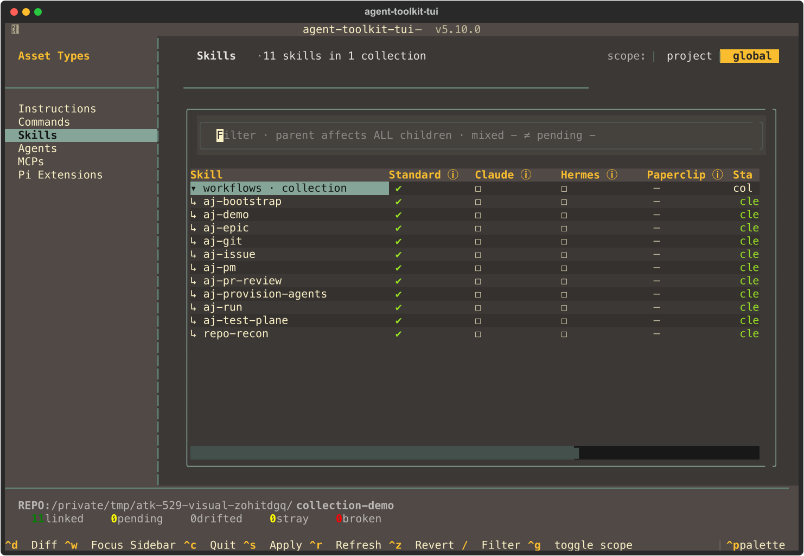
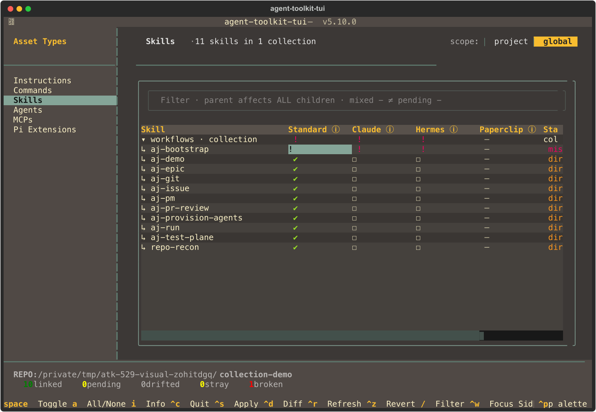
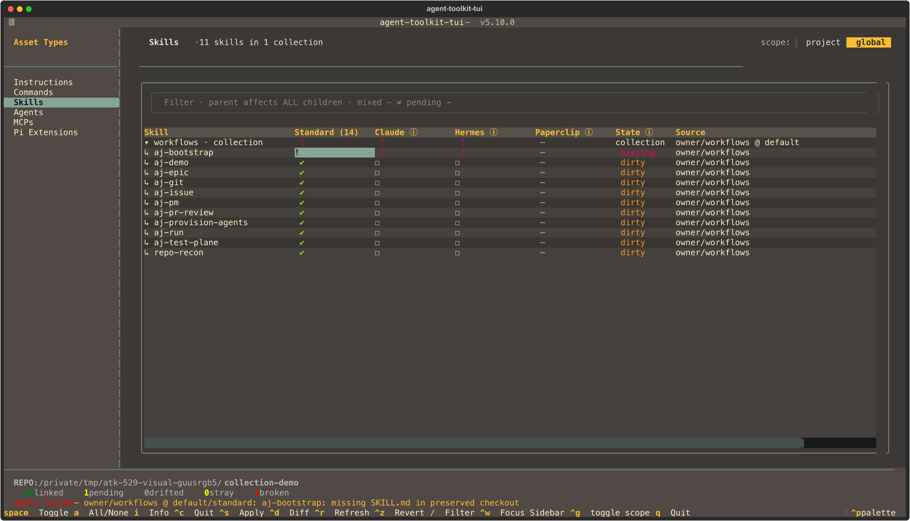

# #529 collection verification

Controlled-fixture screenshots for repository collection selection, preservation failures and truthful missing-document health.

**Capture code SHA:** [`8c14724ef7b7d383b277bbb3d94184fe380290d6`](https://github.com/ajanderson1/agent-toolkit-cli/commit/8c14724ef7b7d383b277bbb3d94184fe380290d6).
The final PR head is bound in the PR body, not embedded as an impossible committed self-hash. The evidence-only commit adds this directory without changing capture/application code.

**Privacy:** all captures use disposable local Git repositories and a fixture workspace/HOME under `/tmp/atk-529-visual-*` (resolved as `/private/tmp/` on macOS). These are controlled test paths, not the operator's HOME, repositories or configuration. No raw logs, transcripts, credentials or live installed assets are published. No visible image text was edited after capture. One insignificant inter-element whitespace-only line per generated SVG was normalized for the Git whitespace check; each PNG byte-matches a fresh render of its matching normalized SVG.

**Capture:** `ATK_529_VISUAL_DIR=assets/verification/529 uv run pytest -q tests/test_tui/test_skill_collection_visuals.py` — two parametrized tests passed, fifteen scenarios at each size. `rsvg-convert` generated and revalidated the PNG pairs. File hashes are in [SHA256SUMS](SHA256SUMS). Full/focused logs remain operator-local; public test results belong to the PR's CI run.

**Judgment:** names, hierarchy and all interactive harnesses are visible at 120x40; State/Source can extend horizontally and Info retains full identity. State/Source also fit at 180x50. Selected-cell highlighting can mask the pending dash color; its child position and the cyan parent mixed mark remain distinct. The images show a fixture, not a claim of universal harness discovery semantics.

| Scenario / verdict | 120x40 | 180x50 |
|---|---|---|
| **01. Hierarchy / totals / unavailable** — PASS: eleven distinct child names under one labelled collection; checked Standard, unavailable Paperclip. | [PNG](120x40-01-all-hierarchy-names-totals-unavailable.png) · [SVG](120x40-01-all-hierarchy-names-totals-unavailable.svg) | [PNG](180x50-01-all-hierarchy-names-totals-unavailable.png) · [SVG](180x50-01-all-hierarchy-names-totals-unavailable.svg) |
| **02. Mixed / child override** — PASS: cyan mixed parent differs from queued child-removal dash; other children remain selected. | [PNG](120x40-02-mixed-and-pending-removal-child-override.png) · [SVG](120x40-02-mixed-and-pending-removal-child-override.svg) | [PNG](180x50-02-mixed-and-pending-removal-child-override.png) · [SVG](180x50-02-mixed-and-pending-removal-child-override.svg) |
| **03. Mixed -> all** — PASS: mixed-parent click restores all selection and cancels the pending child removal. | [PNG](120x40-03-mixed-click-all.png) · [SVG](120x40-03-mixed-click-all.svg) | [PNG](180x50-03-mixed-click-all.png) · [SVG](180x50-03-mixed-click-all.svg) |
| **04. Queued none** — PASS: unchecked parent with eleven queued child removals; no synthetic parent operation. | [PNG](120x40-04-none-queued.png) · [SVG](120x40-04-none-queued.svg) | [PNG](180x50-04-none-queued.png) · [SVG](180x50-04-none-queued.svg) |
| **05. Revert** — PASS: queue cleared, actual all-selected state restored without asset writes. | [PNG](120x40-05-revert-no-writes.png) · [SVG](120x40-05-revert-no-writes.svg) | [PNG](180x50-05-revert-no-writes.png) · [SVG](180x50-05-revert-no-writes.svg) |
| **06. Collapsed full membership** — PASS: one collapsed parent retains the full eleven-child pending count. | [PNG](120x40-06-collapsed-full-membership.png) · [SVG](120x40-06-collapsed-full-membership.svg) | [PNG](180x50-06-collapsed-full-membership.png) · [SVG](180x50-06-collapsed-full-membership.svg) |
| **07. Filtered full membership** — PASS: matching child and parent remain visible; action still queues all eleven children. | [PNG](120x40-07-filter-hidden-full-membership.png) · [SVG](120x40-07-filter-hidden-full-membership.svg) | [PNG](180x50-07-filter-hidden-full-membership.png) · [SVG](180x50-07-filter-hidden-full-membership.svg) |
| **08. Legacy ownership failure** — PASS: parent/child warnings and Apply failure remain visible; request retained, wrapper exposure not falsely disabled. | [PNG](120x40-08-legacy-failure-truthful.png) · [SVG](120x40-08-legacy-failure-truthful.svg) | [PNG](180x50-08-legacy-failure-truthful.png) · [SVG](180x50-08-legacy-failure-truthful.svg) |
| **09. Applied ten children** — PASS: ten selected children, one unchecked child, mixed parent; filesystem assertions prove ten direct links and no wrapper. | [PNG](120x40-09-apply-ten-real-links-mixed.png) · [SVG](120x40-09-apply-ten-real-links-mixed.svg) | [PNG](180x50-09-apply-ten-real-links-mixed.png) · [SVG](180x50-09-apply-ten-real-links-mixed.svg) |
| **10. Mixed -> all pending install** — PASS: exactly one missing child installation is queued. | [PNG](120x40-10-mixed-click-all-pending-child-install.png) · [SVG](120x40-10-mixed-click-all-pending-child-install.svg) | [PNG](180x50-10-mixed-click-all-pending-child-install.png) · [SVG](180x50-10-mixed-click-all-pending-child-install.svg) |
| **11. Revert to actual mixed** — PASS: Revert restores actual ten-child mixed selection, not the discarded all-selected request. | [PNG](120x40-11-revert-to-actual-mixed.png) · [SVG](120x40-11-revert-to-actual-mixed.svg) | [PNG](180x50-11-revert-to-actual-mixed.png) · [SVG](180x50-11-revert-to-actual-mixed.svg) |
| **12. Applied none** — PASS: unchecked parent and children, zero links and zero pending edits. | [PNG](120x40-12-none-applied.png) · [SVG](120x40-12-none-applied.svg) | [PNG](180x50-12-none-applied.png) · [SVG](180x50-12-none-applied.svg) |
| **13. All / idempotent retry** — PASS: all eleven children restored, no fake wrapper or pending edits. | [PNG](120x40-13-all-idempotent-retry.png) · [SVG](120x40-13-all-idempotent-retry.svg) | [PNG](180x50-13-all-idempotent-retry.png) · [SVG](180x50-13-all-idempotent-retry.svg) |
| **14. Missing real skill document** — PASS: actual Refresh shows missing child and parent warnings, ten linked / one broken; directory presence is not healthy selection. | [PNG](120x40-14-missing-document-not-healthy.png) · [SVG](120x40-14-missing-document-not-healthy.svg) | [PNG](180x50-14-missing-document-not-healthy.png) · [SVG](180x50-14-missing-document-not-healthy.svg) |
| **15. Missing document Apply refusal** — PASS: visible Apply error and retained one-child request; no recreation/reset of the deleted document, ten linked / one broken. | [PNG](120x40-15-missing-document-apply-refused.png) · [SVG](120x40-15-missing-document-apply-refused.svg) | [PNG](180x50-15-missing-document-apply-refused.png) · [SVG](180x50-15-missing-document-apply-refused.svg) |

## Representative rendered views

## Limits and remaining gates

Root-on/nested-off combinations with unproven independent isolation are refused before writes; no filtered-root copies or new schema are introduced. A directory/dirty checkout is not proof that a real child's missing SKILL.md is loadable. Images are visual evidence, not substitutes for the required full pytest/strict MkDocs gate, CI or a fresh independent preservation/comprehensive review. No merge approval is claimed here.
